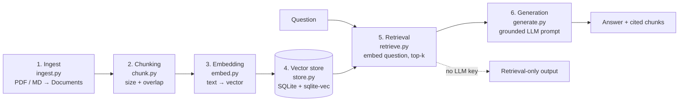

# local-rag-sqlite

[](https://github.com/wchklaus97/local-rag-sqlite/actions/workflows/tests.yml)

**Theme: the anatomy of a RAG pipeline, with chunking as the stage to understand first.**

A small, readable, **local** RAG pipeline you can clone and run. One SQLite file holds the chunks and their vectors ([sqlite-vec](https://github.com/asg017/sqlite-vec)). Each pipeline stage is its own module so you can read the code in the order the data flows.

> The sample corpus is a **fictional** Hong Kong group, *Harbour Lane Group Limited* (HK head office + Shenzhen subsidiary), with bilingual 繁體/廣東話 + English documents in `entity/department/` folders (HR handbook, expense claims, PDPO/compliance, supplier onboarding). Policies are invented for teaching; nothing here is legal or HR advice.

## What you will learn

1. The six stages and what each one is responsible for (and what it is *not*).
2. Why chunk size/overlap belongs to the ingest layer, never the embedding API.
3. How the folder structure of a real company (`entity/department/`) becomes retrieval **metadata**, and why filtering after top-k can return fewer than k results.
4. How to run fully local (SQLite file, optional local model) and how to read retrieval output to debug quality.

## The part you can lift out

[`src/local_rag/chunk.py`](src/local_rag/chunk.py) (`split_text`) is pure Python with no imports from this package. Copy that one file into any project; `tests/test_chunk.py` includes a test that guards this.



Stages 1–4 run once per document set (`rag ingest`). Stages 5–6 run per question (`rag ask`).

## Quickstart

```bash
git clone https://github.com/wchklaus97/local-rag-sqlite.git && cd local-rag-sqlite
uv sync                      # or: python -m venv .venv && source .venv/bin/activate && pip install -e .
uv run rag ingest examples/harbour-lane      # fictional HK group: hk-hq/{hr,finance,compliance}, sz-subsidiary/operations
uv run rag ask "年假申請要提前幾多日？"
uv run rag ask "taxi fare over HKD 300 who approves?" --dept finance
uv run rag ingest examples/learning          # optional: the RAG/chunking teaching notes
```

Out of the box this runs in **retrieval-only mode** with the dependency-free `hash` fallback embedder (keyword-ish, instant, no downloads). For real semantic search install the default local model:

```bash
uv sync --extra local        # sentence-transformers, paraphrase-multilingual-MiniLM-L12-v2 (~470 MB first run)
uv run rag reset --rebuild examples/harbour-lane
```

Switching embedders requires re-ingesting; the store records which embedder built the index and refuses to mix them.

## Commands

| Command | What it does |
|---|---|
| `rag ingest <folder>` | Ingest `.pdf`, `.md`, `.txt` recursively. Re-ingesting a file replaces its chunks. |
| `rag ask "<question>" [-k N] [--dept D] [--entity E]` | Retrieve top-k chunks (shown with score, source and org), optionally limited to a department/entity folder, then generate if an LLM is configured. |
| `rag stats` | Backend, embedder and chunk count per source. |
| `rag reset [--rebuild FOLDER]` | Delete the index file, optionally re-ingest. |

Optional UI: `uv sync --extra ui && uv run streamlit run ui/streamlit_app.py`

## Evaluation (`rag eval`)

`eval/harbour_lane_qa.jsonl` holds 25 hand-written questions (zh-HK + English) about the fictional company, each with the source file and an **evidence string** the retrieved chunk must contain. `rag eval` rebuilds the index for every combination and reports hit@1, hit@k and MRR, overall and per language.

```bash
uv run rag eval                                   # hash embedder, chunk sizes 100/200/400/800, overlap 0/15%
uv sync --extra local && uv run rag eval --embedders hash,local --show-misses
```

Headline from [eval/RESULTS.md](eval/RESULTS.md): English questions on Chinese documents score hit@3 **0.29–0.88 with `hash`** but **0.82–1.00 with the multilingual model**; best overall was multilingual at chunk_size 400 / overlap 60 (hit@3 1.00, MRR 0.82). Read the results file for the traps (chunk_size 800 looks great only because 4 chunks make top-3 trivial; one question = 0.04, so small gaps are noise).

## Configuration

`rag.toml` (env vars override):

| Setting | Env var | Default | Stage |
|---|---|---|---|
| `chunk_size` / `chunk_overlap` | — | 800 / 120 characters | 2 Chunking |
| `embed_provider` | `EMBED_PROVIDER` | `local` (`local`, `hash`, `openai`, `gemini`) | 3 Embedding |
| `embed_model` | `EMBED_MODEL` | provider default | 3 Embedding |
| `db_path` | `RAG_DB` | `rag.db` | 4 Store |
| `top_k` | — | 4 | 5 Retrieval |
| `llm_provider` | `LLM_PROVIDER` | `auto` (`openai`, `gemini`, `ollama`, `none`) | 6 Generation |
| `llm_model` | `LLM_MODEL` | provider default | 6 Generation |

API keys: `OPENAI_API_KEY` (optional `OPENAI_BASE_URL`), `GEMINI_API_KEY`, `OLLAMA_MODEL` (optional `OLLAMA_HOST`). With `llm_provider = "auto"` the first one found is used; with none, you get retrieval-only output.

## What each stage does

1. **Ingest** (`ingest.py`): reads files into `Document(source, page, text)`. PDFs give one document per page. Scanned PDFs without a text layer yield nothing (no OCR here).
2. **Chunking** (`chunk.py`): splits documents into passages by `chunk_size` and `chunk_overlap`, preferring paragraph/sentence/word boundaries.
   *Why this is configured in the RAG layer and not in the embedding call:* an embedding API turns one string into one vector. It has no chunk-size or overlap parameter and does not split documents; over-long input is truncated or rejected. The retrieval unit is your decision.
3. **Embedding** (`embed.py`): `list[str] → list[vector]`. Pluggable providers.
4. **Vector store** (`store.py`): tables `chunks` (text, source, page, chunk_index) and a `vec0` virtual table of cosine-distance vectors. If the sqlite-vec extension can't load (some Python builds disable extension loading, e.g. certain macOS system Pythons), it falls back to a pure-Python scan with the same API; `rag stats` shows which backend is active.
5. **Retrieval** (`retrieve.py`): embeds the question with the same embedder, returns the top-k chunks by cosine similarity.
6. **Generation** (`generate.py`): grounded prompt (“answer only from numbered context, cite [n], say you don't know otherwise”).

## Layout

```
src/local_rag/  config.py ingest.py chunk.py embed.py store.py retrieve.py generate.py cli.py
examples/       harbour-lane/ (fictional HK group, bilingual) and learning/ (teaching notes on RAG + chunking)
tests/          chunking, store round-trip (sqlite-vec and fallback), end-to-end pipeline
ui/             optional Streamlit app
LEARNING.md     what / why / common mistakes (繁體中文 zh-HK + English)
```

## Tests

```bash
uv sync --extra dev && uv run pytest
```

## Run with OpenRouter (or any OpenAI-compatible API)

Keep the key in your shell (e.g. `~/.zshrc`), never in the repo. `.env` files are git-ignored.

```bash
export OPENROUTER_API_KEY="..."
export OPENAI_API_KEY="$OPENROUTER_API_KEY"
export OPENAI_BASE_URL="https://openrouter.ai/api/v1"
```

```bash
LLM_PROVIDER=openai LLM_MODEL=openai/gpt-4o-mini uv run rag ask "Who must approve a taxi fare over HKD 300?" --dept finance
```

Model names use OpenRouter's `vendor/model` form. Embeddings stay local (`local` or `hash`); this demo does not send document embeddings to OpenRouter.

### Live tests (opt-in, cost a few cents)

```bash
RUN_LIVE_LLM=1 LIVE_MODEL=openai/gpt-4o-mini uv run pytest tests/test_live_llm.py -v
```

They are skipped in a normal `uv run pytest`. They check grounded answers, citations, filters and "I don't know" for out-of-scope questions.

## Contributing

Good first issues: a Markdown-heading-aware splitter, a token-based size option, OCR for scanned PDFs, an eval script (question → expected source). Keep `chunk.py` dependency-free. MIT licensed.

## Series

Four small open-source demos built around one fictional Hong Kong company, each with one theme and one module you can lift out:

| Repo | Theme | Lift-out module |
|---|---|---|
| [local-rag-sqlite](https://github.com/wchklaus97/local-rag-sqlite) | Classic RAG pipeline, chunking first | `chunk.py` |
| [multimodal-page-rag](https://github.com/wchklaus97/multimodal-page-rag) | Page-level units + late fusion | `fusion.py` |
| [agent-rag-pydantic-ai](https://github.com/wchklaus97/agent-rag-pydantic-ai) | Retrieval as an agent tool | `tools.py` |
| [hybrid-search-rag](https://github.com/wchklaus97/hybrid-search-rag) | Hybrid BM25 + vector + rerank for code-mixed text | `cjk_tokenize.py` |

Why are `chunk.py`, `embed.py`, `store.py` and `_http.py` copied between repos instead of shared as a package? Deliberately: each repo must clone and run on its own, and a teaching repo should not turn into a dependency chain. The cost is that a fix in one repo does not reach the others.

## License

MIT
